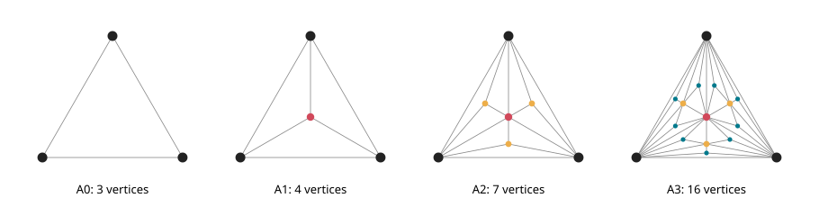

# Snort on Apollonian networks

This repository computes the exact combinatorial-game value of **Snort** played on the
deterministic **Apollonian network** of each recursion depth, starting from the trivial
three-vertex case. It also explores the structure behind those values and proposes
conjectures for the general case.



**Summary.**

| depth n | vertices | value of Snort on Aₙ | temperature | Δ (max degree) |
|---|---|---|---|---|
| 0 | 3 | ±2 | 2 | 2 |
| 1 | 4 | ±3 | 3 | 3 |
| 2 | 7 | ±6 | 6 | 6 |
| 3 | 16 | ±10 | 10 | 12 |
| 4 | 43 | DEPTH4_VALUE | DEPTH4_TEMP | 24 |

For every depth computed, Left's best first move is the **centre** (the first inserted
vertex), and the game is a switch {Cₙ | −Cₙ}. Here Cₙ is the position after Left colours the
centre. Cₙ is an integer for n ≤ 3 (3, 6, 10) but **not** at n = 4, where C₄ = {23 | 22}.
Section 7 lists the conjectures.

---

## 1. Set-up

**Snort.** Left colours vertices blue and Right colours vertices red. A player may never
colour a vertex adjacent to a vertex of the *opponent's* colour. Under normal play, whoever
cannot move loses. A vertex adjacent to a blue vertex is *tinted* for Left: only Left can
still colour it. A vertex tinted for both players is dead. Values are canonical forms of
short partizan games (Conway, *On Numbers and Games*; Siegel, *Combinatorial Game
Theory*).

Notation: `±x` is the switch `{x | −x}`, `a±b` is `{a+b | a−b}`, `*` is star, and nested
braces are written out in full. Snort on an uncoloured graph is symmetric under swapping the
colours, so every value G below satisfies G = −G. Hence its mean is 0, G + G = 0, and the
game is either 0 or a first-player win.

**Apollonian networks.** `A0` is a triangle. `A(n+1)` is obtained from `An` by inserting a
new vertex into every inner triangular face created at the previous step and joining it to
that face's three corners. Vertex 3, inserted at depth 1, is the **centre**. A vertex
inserted at step *j* has *level* *j*; the outer corners have level 0.

| n | vertices 3+(3ⁿ−1)/2 | edges 3\|V\|−6 | centre degree 3·2ⁿ⁻¹ | corner degree 2ⁿ+1 | level-j degree 3·2ⁿ⁻ʲ | automorphisms |
|---|---|---|---|---|---|---|
| 0 | 3 | 3 | – | 2 | – | 6 |
| 1 | 4 | 6 | 3 | 3 | 3 | 24 |
| 2 | 7 | 15 | 6 | 5 | 6, 3 | 6 |
| 3 | 16 | 42 | 12 | 9 | 12, 6, 3 | 6 |
| 4 | 43 | 123 | 24 | 17 | 24, 12, 6, 3 | 6 |
| 5 | 124 | 366 | 48 | 33 | 48, …, 3 | 6 |

From depth 2 on, the centre is the unique vertex of maximum degree, Δ(Aₙ) = 3·2ⁿ⁻¹.

## 2. Values of Snort on Aₙ

| n | \|V\| | \|E\| | Δ | canonical value | temperature | Left / Right stop | outcome | canonical subpositions | birthday |
|---|---|---|---|---|---|---|---|---|---|
| 0 | 3 | 3 | 2 | ±2 | 2 | 2 / −2 | 𝒩 | 6 | 3 |
| 1 | 4 | 6 | 3 | ±3 | 3 | 3 / −3 | 𝒩 | 8 | 4 |
| 2 | 7 | 15 | 6 | ±6 | 6 | 6 / −6 | 𝒩 | 14 | 7 |
| 3 | 16 | 42 | 12 | ±10 | 10 | 10 / −10 | 𝒩 | 22 | 11 |
| 4 | 43 | 123 | 24 | DEPTH4_VALUE | DEPTH4_TEMP | DEPTH4_STOPS | 𝒩 | DEPTH4_SIZE | DEPTH4_BDAY |

*Mean* is 0 throughout. 𝒩 means the first player wins. Depth 5 has 124 vertices and is out of
reach of the exhaustive method used here (Section 8).

Depths 0–2 are instances of a simple fact, also noted by Huntemann–Nowakowski–Santos: a
graph on m+1 vertices with a vertex u adjacent to all others has Snort value ±m. Proof: any
position P with k uncoloured vertices satisfies P ≤ k, by induction (every P^L has k−1
vertices, so P^L ≤ k−1 < k, and the integer k has no Right option). Colouring u leaves m
Left-tinted vertices, i.e. the integer m, and every other Left option is ≤ m, hence
dominated. A3 is the first case without such a vertex, and its value ±10 falls below Δ = 12.

### Left's first moves

Values of the position after Left colours one vertex, one row per orbit of the automorphism
group. Right's moves are the negatives. "≤ C" means the move is dominated by the centre move.

| n | vertex (level, degree) | value after Left's move | mean | temperature | ≤ C |
|---|---|---|---|---|---|
| 2 | corner (0, 5) | 7/2±3/2 | 7/2 | 3/2 | yes |
| 2 | **centre (1, 6)** | **6** | 6 | — (number) | — |
| 2 | level 2 (2, 3) | 3/2±7/2 | 3/2 | 7/2 | yes |
| 3 | corner (0, 9) | {23/2±3/2 \| 2} | 27/4 | 19/4 | yes |
| 3 | **centre (1, 12)** | **10** | 10 | — (number) | — |
| 3 | level 2 (2, 6) | {{13 \| 8±1} \| −2, ±4} | 17/4 | 25/4 | yes |
| 3 | level 3 (3, 3), next to the centre | {9 \| {−3 \| −17/2±1/2}} | 13/8 | 59/8 | yes |
| 3 | level 3 (3, 3), next to a corner | {{13 \| 8±1} \| {−13/2±1/2 \| −10}} | 9/8 | 75/8 | yes |
DEPTH4_MOVES

At depth 3 the corner move K = {{13|10} | 2} has Left option {13|10}, which is *confused
with* 10 ({3|0} is a first-player win). K is nevertheless ≤ 10 and therefore dominated. So the
canonical form keeps a single Left option, and the value collapses to the pure switch ±10.

## 3. Anatomy of the centre move

After Left colours the centre c, its Δ = 3·2ⁿ⁻¹ neighbours are Left-tinted. Every remaining
untinted vertex lies inside a triangle whose three corners are all Left-tinted. Each such
untinted region is the interior of a sub-network of depth n−2 (3 of them), n−3 (6 of them),
…, 1 (3·2ⁿ⁻³ of them), so 3(2ⁿ⁻²−1) *Left-cornered pockets* in all. Neighbouring pockets
share corners. The number of untinted vertices is 3·N(n−1), where N(0) = N(1) = 0 and
N(m) = (3ᵐ⁻¹−1)/2 + 2N(m−1). That gives 0, 0, 3, 18, 75 for n = 1, …, 5.

Edges between two Left-tinted vertices are irrelevant (Section 8), so tinted neighbours of c
with no untinted neighbour are isolated +1's. The rest forms one connected component Bₙ.

| n | Δ | isolated +1's | Bₙ: tinted + untinted vertices | value of Bₙ | Cₙ | Δ − mean(Cₙ) |
|---|---|---|---|---|---|---|
| 1 | 3 | 3 | – | – | 3 | 0 |
| 2 | 6 | 6 | – | – | 6 | 0 |
| 3 | 12 | 6 | 6 + 3 | 4 | 10 | 2 |
| 4 | 24 | 12 | 12 + 18 | {11 \| 10} | {23 \| 22} | 3/2 |

B₃ is a hexagon a–x–b–y–c–z (tinted corners a, b, c alternating with untinted x, y, z), with a
tinted pendant on each of x, y, z. Right's move at a pocket's centre kills all three of its
tinted corners at once, so in isolation a pocket costs Left about half of its corners. A lone
pocket T_k (Section 4) has mean 3/2, 3/2, 5/4 against 3 tinted corners. But pockets share
corners, and the total *deficit* Δ − mean(Cₙ) is only 2 at n = 3 (three pockets) and 3/2 at
n = 4 (nine pockets). So far it does not grow with the number of pockets.

## 4. Building blocks

Two families of sub-games recur inside these positions:

* **T_k**: the depth-k network with its three corners Left-tinted and its interior
  untinted (a lone pocket).
* **I_k(x, y, z)**: the interior of the depth-k network once its corners are *resolved*.
  Each corner is coloured by Left (L), by Right (R) or is dead (0). Once a separating triangle
  is resolved, its inside is an independent summand with exactly this value.

| block | k = 1 | k = 2 | k = 3 | k = 4 |
|---|---|---|---|---|
| T_k (pocket) | 3/2±3/2 | 3/2±9/2 | {10 \| −15/2±1/2} | not computed |
| I_k(0, 0, 0) (open interior) | * | ±3 | ±(15/2±1/2) | not computed |
| I_k(0, 0, L) | 1 | 5/2±1/2 | {21/2±1/2 \| 2} | {{31 \| 45/2±1/2} \| 5} |
| I_k(0, L, L) | 1 | 4 | {12 \| 17/2±1/2} | {67/2±1/2 \| 37/2±({6±1/2 \| 5/2})} |
| I_k(L, L, L) | 1 | 4 | 13 | **34±5** |
| I_k(L, L, R) | 0 | 1 | 4 | {12 \| 17/2±1/2} |
| I_k(0, L, R) | 0 | 0 | 0 | 0 |

The remaining cases follow by colour symmetry, e.g. I_k(L, R, R) = −I_k(L, L, R). Means and
temperatures at k = 4: I₄(0,0,L) has m = 127/8, t = 87/8; I₄(0,L,L) has m = 26, t = 15/2;
I₄(L,L,L) has m = 34, t = 5; I₄(L,L,R) has m = 41/4, t = 7/4. T₄ and I₄(0,0,0) are as large
as A₄ itself and were not computed.

Observations:

* **I_k(0, L, R) = 0 for every k (theorem).** Reflect in the axis through the dead corner.
  The fixed vertices are exactly the centres on that axis, and each is adjacent to both
  coloured corners, so all are dead. No edge joins a vertex to its mirror image, and the
  reflection swaps L-tints with R-tints. The second player therefore wins by answering a move
  at v with the opposite colour at its mirror image.
* **Mixed corners split (theorem).** If the corners carry both colours, the centre of the
  triangle is adjacent to both and dies. Its inside then falls apart into three independent
  sub-interiors, so I_k(L, L, R) = I_{k−1}(0, L, L) + 2·I_{k−1}(0, L, R) = I_{k−1}(0, L, L).
  So the essential blocks are T_k, I_k(0,0,0), I_k(0,0,L), I_k(0,L,L) and I_k(L,L,L).
* **Fully Left-cornered interiors are not always integers.** For k ≤ 3 every interior
  vertex touches a corner, so I_k(L, L, L) is trivially (3ᵏ−1)/2. At k = 4 there are 6
  untinted interior vertices, and I₄(L, L, L) = 34±5 = {39 | 29}. Left cannot secure all 40
  vertices even moving first, and Right moving first holds Left to 29.
* **Means track tints.** In every block above, the mean is within 2 of (number of
  Left-tinted vertices) − (number of Right-tinted vertices): untinted regions are worth
  about 0 on average. At k = 4: I(L,L,L) has 34 tinted vertices and mean 34; I(0,L,L) has 26
  and mean 26; I(0,0,L) has 15 and mean 127/8. Pockets T_k have 3 and mean 3/2, 3/2, 5/4.
  The centre-move positions Cₙ have Δ and mean Δ, Δ, Δ−2, Δ−3/2.
* The *open* interior I_k(0, 0, 0) (Aₖ minus its outer triangle) is *, ±3, ±(15/2±1/2) for
  k = 1, 2, 3.

## 5. Context: all planar 3-trees

Aₙ is the most symmetric member of the class of **planar 3-trees**: triangulations built
from a triangle by repeatedly stacking a vertex into *any* face, also called Apollonian
networks in the broad sense. To see which features are special to Aₙ, every planar 3-tree
with at most 13 vertices was evaluated (13,677 graphs up to isomorphism; the class counts
1, 1, 1, 1, 3, 7, 24, 93, 434, 2110, 11002 for 3, …, 13 vertices agree with OEIS A027610). So were 1,000 random
ones with up to 26 vertices.

SURVEY_TABLES

Findings:

* **Every** planar 3-tree in both samples is hot (a first-player win), and **every** one
  satisfies t ≤ Δ.
* Among all planar 3-trees on ≤ 13 vertices, **t = Δ holds exactly when the graph has a
  vertex adjacent to all others** (1,093 graphs; then the value is ±Δ). The counts with
  t = Δ, namely 4, 12, 27, 82, 228, 733, are the numbers of triangulated polygons up to
  symmetry (OEIS A000207), as they must be.
* Pure switches ±x without a universal vertex are rare: 21 graphs on 12 vertices are ±6 with
  Δ = 9, and 306 on 13 vertices are ±7. A₃ = ±10 (Δ = 12) belongs to this group.
* The temperature of a planar 3-tree can be much smaller than Δ. The coldest case on 12
  vertices has t = 2, Δ = 6. Such cases are path-like stackings: for the cube of a path
  Pₘ³ (vertex i joined to i±1, i±2, i±3, the "linear" planar 3-tree) the temperature stays
  between 2 and 6 for all m ≤ 40. In contrast, t(Aₙ) roughly doubles with each level.

## 6. Variant: subdividing both faces of the triangle

If the initial triangle is viewed on the sphere and *both* of its faces are refined, the
depth-1 graph is the triangular bipyramid. The values become more intricate, and the best
first move is now an outer corner (degree 2ⁿ⁺¹):

| n | \|V\| | Δ | value | temperature | stops |
|---|---|---|---|---|---|
| 0 | 3 | 2 | ±2 | 2 | 2 / −2 |
| 1 | 5 | 4 | ±4 | 4 | 4 / −4 |
| 2 | 11 | 8 | ±({9 \| 9/2±1/2}) | 27/4 | 5 / −5 |
| 3 | 29 | 16 | ±({{26 \| {41/2±1/2 \| 17}} \| {25/2±1/2 \| 4}}) | 245/16 | 12 / −12 |

Here too t ≤ Δ, with t/Δ = 1, 1, 0.84, 0.96.

## 7. Conjectures

Let c be the centre of Aₙ and Cₙ the position after Left colours it.

1. **(Shape of the value.) The centre is the only good first move.** For every n ≥ 1,
   every first move other than at c is dominated by the move at c, so
   **Aₙ = {Cₙ | −Cₙ} = ±Cₙ**. *(Verified for n ≤ 4.)*
2. **(Cₙ is nearly cold.)** Cₙ has temperature at most 1/2. It is an integer for n ≤ 3
   (3, 6, 10) and C₄ = {23 | 22}. Consequently Aₙ is, up to a tiny tepid part, the switch
   ±mₙ with mₙ = mean(Cₙ). Its stops are ±(right stop of Cₙ) and its temperature is
   **t(Aₙ) = mean(Cₙ)**. *(n ≤ 4.)*
3. **(Temperature is governed by the centre's degree.)**
   t(Aₙ) ≤ Δ(Aₙ) = 3·2ⁿ⁻¹, with equality iff n ≤ 2. The deficit Δ − t(Aₙ) = 0, 0, 0, 2, 3/2
   stays bounded: **t(Aₙ) = 3·2ⁿ⁻¹ − O(1)**. In terms of size, t(Aₙ) grows like
   |V|^(log 2 / log 3) ≈ |V|^0.63. That is strictly between the bounded temperatures of
   path-like planar 3-trees and the linear growth of stars and complete graphs.
   *(Weakest of the conjectures. The supporting evidence is the two values 2 and 3/2 and the
   pocket-sharing mechanism of Section 3. A safer version is t(Aₙ) = Θ(2ⁿ), i.e.
   εΔ ≤ t(Aₙ) ≤ Δ for some ε > 0.)*
4. **(Planar 3-trees obey the degree bound.)** For every planar 3-tree G, Snort on G is hot
   (a first-player win) and **t(G) ≤ Δ(G), with equality iff G has a universal vertex.**
   This is the "temperature ≤ degree" conjecture of Huntemann–Nowakowski–Santos (2019)
   restricted to planar 3-trees. That conjecture is false for general graphs: Huntemann and
   Maciosowski (2024) give caterpillars with t = 2Δ − 3. *(Verified exhaustively for
   |V| ≤ 13 and on 1,000 random examples with |V| ≤ 26.)*
5. **(Means are tint counts up to O(1).)** For the positions arising in Aₙ (pockets,
   resolved interiors, Cₙ), |mean − (#Left-tinted − #Right-tinted)| stays bounded
   independently of the depth. All computed cases are within 2. Conjecture 3 is the special
   case Cₙ. This fails for general graphs: a Left-tinted vertex with many untinted leaves is
   worth far more than 1. So the claim is specific to these triangulated pockets.
6. **(Open interiors.)** The open interior I_k(0, 0, 0) is a symmetric switch whose
   temperature grows like 2ᵏ (0, 3, 15/2 for k = 1, 2, 3).

*Refuted along the way.* From k ≤ 3 it was tempting to conjecture that a triangle with all
three corners coloured has an integer inside (I_k(L,L,L) = (3ᵏ−1)/2,
I_k(L,L,R) = (3ᵏ⁻¹−1)/2). k = 4 refutes both: I₄(L,L,L) = 34±5 and
I₄(L,L,R) = {12 | 17/2±1/2}.

## 8. Method and verification

* `cgt.py`: a self-contained canonical-form engine for short partizan games. It covers
  hash-consed canonical forms, removal of dominated options and bypassing of reversible ones,
  sums with number translation, comparison, dyadic numbers, and thermographs (temperature,
  mean and stops).
* `snort.py`: Snort positions as bitmasks (alive, Left-tinted, Right-tinted). Two exact
  reductions are applied. Edges between two equally tinted vertices are deleted (colouring
  one end only re-tints the other with the tint it already has). Positions are then split
  into connected components and their values summed. Components are memoised up to the
  automorphisms of the host graph and up to colour swap (which negates the value).
* `csrc/snort.cpp`: the same algorithm in C++ for speed (depth 4 explores about NCOMP4
  distinct components). `snortc.py` imports its output into `cgt.py`. By default it
  re-canonicalises every node, so the Python engine re-checks the C++ result.
* `tests/test_engine.py` checks the engine against independent brute force:
  * outcome classes of hundreds of random Snort positions against plain minimax;
  * outcomes of disjoint unions against the sum of the canonical values;
  * every claimed equality G = H, by brute-force search on Snort(G) + (−H), which must be a
    second-player win;
  * values with and without component decomposition, known values (Kₙ = ±(n−1), stars
    K₁,ₙ = ±n), thermographs, the C++ back end against the Python reference, and the
    planar-3-tree counts.

```
python3 tests/test_engine.py           # all checks (about a minute)
python3 explore.py 3                   # Sections 2 table, depths 0–3 (seconds)
python3 explore.py 4                   # adds depth 4 (C++; DEPTH4_TIME, a few GB of RAM)
python3 explore.py 3 --both-faces      # Section 6
python3 blocks.py 4                    # Section 4
python3 enumerate_3trees.py 13 > data/planar3trees.jsonl
python3 random_apollonian.py 4 18 40 1 > data/random_apollonian.jsonl
python3 summarize.py                   # Section 5 tables
python3 figure.py > docs/apollonian.svg
```

Raw results are in `data/`.

## References

* E. Berlekamp, J. Conway, R. Guy, *Winning Ways for your Mathematical Plays* (Snort is
  due to Simon Norton).
* A. N. Siegel, *Combinatorial Game Theory*, AMS Graduate Studies in Mathematics 146 (2013).
* S. Huntemann, R. J. Nowakowski, C. P. dos Santos, *Bounding game temperature using
  confusion intervals*, Theoret. Comput. Sci. 855 (2021) 43–60,
  [arXiv:1908.08471](https://arxiv.org/abs/1908.08471). Graphs with a universal vertex;
  the conjecture t ≤ degree.
* S. Huntemann, T. Maciosowski, *Degrees are useless in Snort when measuring temperature*
  (2024), [arXiv:2406.02107](https://arxiv.org/abs/2406.02107). Counterexamples to
  t ≤ degree and stars K₁,ₙ = ±n.
* J. S. Andrade Jr., H. J. Herrmann, R. F. S. Andrade, L. R. da Silva, *Apollonian
  networks*, Phys. Rev. Lett. 94 (2005) 018702.
* OEIS [A027610](https://oeis.org/A027610) (planar 3-trees) and
  [A000207](https://oeis.org/A000207) (triangulations of a polygon up to symmetry).
